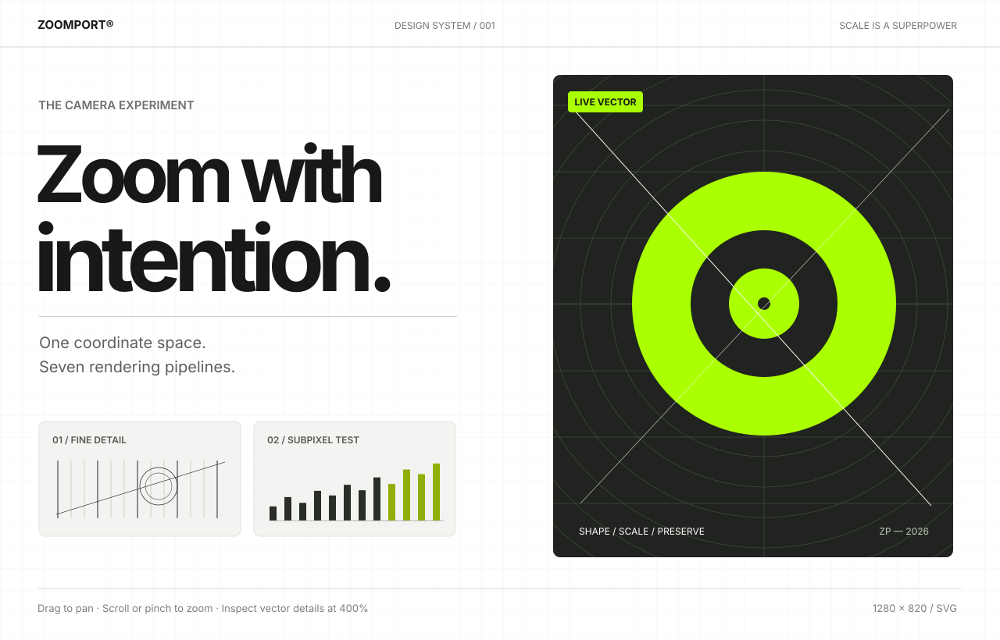

# ZoomPort

Headless pan/zoom camera physics with React components, vanilla DOM/SVG adapters, Canvas 2D support, and Effect v4 bindings. Use one camera across renderers without rewriting gesture input or coordinate math.

[](https://github.com/thelabcorner/zoomport/actions/workflows/ci.yml) [](LICENSE)  

> **Status: pre-release**. The first implementation is functional, with unit tests and a playground. Do not assume verified visual parity on Safari, mobile pinch, high-DPI panels, or production GPU workloads until browser-matrix evidence is published.

**[Open the live playground](https://thelabcorner.github.io/zoomport/)** · [100K-object performance lab](https://thelabcorner.github.io/zoomport/culling.html) · [Vanilla JavaScript demo](https://thelabcorner.github.io/zoomport/vanilla.html)

[](https://thelabcorner.github.io/zoomport/)

The demos run entirely in the browser and deploy from `.github/workflows/pages.yml`. They use the repository's actual camera, input, DOM, SVG, Canvas and culling code, not a separate simulated implementation.

## Why ZoomPort?

A pan/zoom *camera* should not dictate how its content is drawn. ZoomPort decouples world-space coordinates, gesture input, interpolation, and constraints from the renderer. The exact same camera drives CSS-transformed DOM, repaint-aware DOM, SVG groups, native SVG viewBox geometry, Canvas 2D, and custom WebGL/WebGPU scenes.

- **Precise geometry.** Cursor anchoring, screen/world conversion, fit-to-bounds, optional content constraints.
- **One animation owner.** Timestamp-based interpolation in log-scale and analytic momentum integration; no overlapping panning and zoom timers.
- **Headless.** No required CSS framework, design tokens, or global stylesheet.
- **Rendering freedom.** Optimize for compositor throughput *or* native vector sharpness.
- **React containment.** The camera writes to subscribers directly. Only consumers of `useCamera()` (and explicitly provided callbacks) receive frame updates.
- **Composable.** `ZoomPort.Root`, `ZoomPort.Viewport`, `ZoomPort.Content`, `SVGContent`, `SVGViewport`, `Image`.
- **Accessibility.** Focusable, labeled viewport; arrows to pan, +/− to zoom, 0 to fit; honors OS reduced motion when not explicitly overridden.
- **Integration.** Core has no React dependency; React 18/19 peer APIs. DOM, SVG, Canvas 2D and custom rendering callbacks.
- **Scalable scheduling.** One pooled browser animation request for active cameras, and optional per-frame pointer coalescing for high-rate input.

See [performance engineering and measured browser profiles](docs/PERFORMANCE.md)
for 60Hz browser counters, input throughput, renderer tradeoffs, and
limitations before choosing a rendering strategy.

### Large-scene performance

ZoomPort includes a world-space `SceneIndex` bounding-volume hierarchy,
`SceneVisibility` with guarded camera-space culling, and hierarchical
semantic level-of-detail queries. A framework-free `connectDOMCulling`
adapter can hide offscreen DOM/SVG elements without altering React state.
Canvas/WebGL consumers can draw only indexed candidates or replace distant
objects with scene-specific cluster representations.

**Try the 100,000-object interactive performance lab:** [`/culling.html`](apps/playground/culling.html).
Compare naive rendering, indexed per-object culling, and native BVH-derived
LOD using one continuous camera. See the [scene performance engineering
guide](docs/SCENE-PERFORMANCE.md) for APIs, correctness constraints, measured
benchmarks, and tradeoffs. CPU and draw-call reductions do not imply
equivalent increases in browser FPS.

## Getting started

This workspace contains four independent publishable packages and a playground:

```sh
npm install
npm run check
npm run dev
```

### Choose your integration

| Package | Framework dependency | Recommended when |
| --- | --- | --- |
| `@zoomport/core` | None | Building your own renderer or input system |
| `@zoomport/dom` | None | Vanilla HTML/JS, SVG, Canvas, Web Components |
| `@zoomport/react` | React 18 or 19 | Composable React component primitives |
| `@zoomport/effect` | Optional Effect 4 | Scoped resource lifecycles, camera streams |

Each package is ESM-only and TypeScript-first. The DOM entry point has no
React or Effect dependency. `@zoomport/react` reuses `@zoomport/dom`'s
actual input and rendering adapters rather than maintaining a divergent fork.
See [Integration guide](docs/INTEGRATION.md) and the individual package READMEs.

**Try the plain HTML demo:** start the Vite server and open `/vanilla.html`.
It shares the same renderer implementations as the React playground but
runs without React.

### Mobile/LAN interactive demo

The responsive playground is a ForgePrint-inspired light workbench, styled with
zinc hairlines and the ZoomPort `#AAFF00` primary accent. Its vector scene
exposes **seven actual renderers** (four CSS, two native SVG, and real Canvas 2D).
The image scene exposes four CSS/image rendering strategies. Switching between
renderers within the same scene preserves the camera while changing the
underlying DOM/SVG/canvas mechanism.

The live runtime inspector reads mounted native element properties (CSS
`transform`, `zoom`, dimensions, SVG transforms or `viewBox`, and Canvas pixel
buffer dimensions) rather than merely echoing the selected label. Inspection
is sampled at a bounded cadence to avoid contaminating camera-frame performance.
Scene fitting, pinch/drag, fit/zoom/reset, keyboard interactions, motion
configuration, and immersive full-screen mode are included.

See [Playground style guide](apps/playground/STYLE_GUIDE.md) for the exact
design and behavioral contract.

```sh
npm run dev:lan
```

Open `http://<workstation-LAN-IP>:11274/` on a phone connected to the same
LAN. The server binds to `0.0.0.0` and Vite prints the applicable LAN addresses;
`0.0.0.0` is a **bind address**, not a phone destination. If a local firewall
blocks connections, allow inbound TCP **11274** on the trusted private network
only. Do not forward this development port to the public internet.

If you temporarily allow inbound traffic for testing, restrict access to
your private network and remove the firewall rule afterward.

The mobile viewport is exercised using Playwright browser tests:

```sh
npm run test:browser
```

Set `ZOOMPORT_ALL_BROWSERS=1` to exercise Chromium, Firefox, and WebKit
(when installed). Browser emulation and CDP touch injection do not substitute
for physical iPhone/Android gesture and device-pixel-ratio validation.

After package publication:

```sh
npm install @zoomport/react
```

The package names and npm namespace are **not yet verified as available or published**.

### React quick start

```tsx
import { ZoomPort } from "@zoomport/react"

export function Gallery() {
  return (
    <ZoomPort.Root minScale={0.25} maxScale={12} wheelMode="zoom">
      <ZoomPort.Viewport aria-label="Artwork" style={{height:480}}>
        <ZoomPort.Content>
          
        </ZoomPort.Content>
      </ZoomPort.Viewport>
    </ZoomPort.Root>
  )
}
```

### Crisp SVG: transform actual vector geometry

```tsx
<ZoomPort.Root minScale={0.1} maxScale={40}>
  <ZoomPort.Viewport style={{width:"100%",height:600}}>
    <svg width="100%" height="100%">
      <ZoomPort.SVGContent>
        <path d="M0 0 L400 0 L400 200Z" fill="#a6a2fc" />
      </ZoomPort.SVGContent>
    </svg>
  </ZoomPort.Viewport>
</ZoomPort.Root>
```

### Crisp SVG: native viewBox camera

```tsx
<ZoomPort.Root minScale={0.1} maxScale={50}>
  <ZoomPort.Viewport style={{height:600}}>
    <ZoomPort.SVGViewport>
      <path d="M0 0 L200 0 L200 200Z" fill="coral" />
    </ZoomPort.SVGViewport>
  </ZoomPort.Viewport>
</ZoomPort.Root>
```

The SVG remains paths. There is no `canvas.toDataURL()` or bitmap freeze. The viewBox adapter uses `preserveAspectRatio="none"` intentionally so its world-to-screen transform remains exact when the host SVG's CSS box changes aspect ratio.

### Stepped high-resolution CSS zoom

```tsx
<ZoomPort.Content
  renderMode="css-hybrid"
  intrinsicSize={{width:1200,height:800}}
  maxLayerPixels={16_000_000}
  maxDevicePixels={32_000_000}
  maxDeviceDimension={8192}
  style={{width:1200,height:800}}
>
  <svg viewBox="0 0 1200 800" width="100%" height="100%">
    <text x="50" y="120">Native vector source</text>
  </svg>
</ZoomPort.Content>
```

Hybrid mode enlarges the **painted element** in 1×, 2×, 4×… tiers, then applies `scale(camera.scale / tier)` to interpolate between tiers. Tier changes cause repaint/layout; intermediate frames use a CSS transform. Children **must respond to resized parent dimensions** (for instance, an inline SVG with `width="100%" height="100%" viewBox="0 0 1200 800"`). A fixed 1200px-wide child will *not* scale correctly when its parent switches tiers. Tier escalation is limited by `maxLayerPixels` (CSS pixels before DPR) and optionally `maxDevicePixels` (physical pixels at `pixelRatio` or the current device DPR). A 1× layer cannot be shrunk below its intrinsic dimensions to satisfy an undersized budget. At higher zoom levels compositing can again upscale a layer. This is a performance/fidelity tradeoff—not a platform-wide anti-blur guarantee.

For raster images, no resampling filter can restore detail absent from the source. Use `ZoomPort.Image` with a high-resolution source (or progressive URL provider):

```tsx
<ZoomPort.Image
  src="/image-1024.jpg"
  alt="High-resolution artwork"
  intrinsicWidth={1200}
  intrinsicHeight={800}
  decodeBeforeSwap
  resolveSource={({bucketWidth}) => `/api/image?w=${bucketWidth}`}
/>
```

The resolver requests power-of-two source widths rather than requesting a different image on every frame. Source URL changes may trigger decoding/fetching, so production pipelines should cache resolutions and consider asynchronous crossfades.

**Source-cap detail:** `maxSourceWidth` can be any positive width, not only a power of two. A 1000px cap offers a final 1000px tier rather than unexpectedly stopping at 512px. Native HTML `srcset`/`sizes` is also available when browser-owned source selection is preferable.

Opt into `decodeBeforeSwap` for progressively loaded images: the previous source remains visible until its replacement has decoded, and a superseded asynchronous request cannot overwrite the currently requested tier. Failed decodes keep the last working image. This deliberately incurs a temporary second decoded image; omit it when memory usage and immediate source swaps matter more. The default remains immediate switching for backward compatibility.

## Renderer guide

| Renderer | How it works | Advantage | Cost / caveat |
| --- | --- | --- | --- |
| `css-transform` | `translate + scale` | Fast and versatile | Compositor may magnify a cached layer |
| `css-hybrid` | Tiered native sizing + residual CSS scale | Sharper vector/text at moderate zoom | Occasional relayout, GPU memory ceiling |
| `css-layout` | CSS `zoom` | Paint/layout-aware DOM magnification | Layout work, differing layout semantics |
| `css-resize` | Update native width/height every frame | Native SVG/img dimensions | Layout/paint each frame; responsive children required |
| `svg-transform` | Apply `<g transform>` | Retains SVG vector shapes | Large SVG trees have paint cost |
| `svg-viewbox` | Change SVG root `viewBox` | Native world-space viewport | Requires SVG coordinate ownership |
| `canvas2d` | Redraw at CSS pixel size × DPR | Fresh high-DPI backing store | Redraw cost, caller implements scene |
| `custom` | Camera subscription | WebGL/WebGPU/Three/PIXI | App owns GPU memory, LOD and shader logic |

`image-rendering: pixelated` and `crisp-edges` are not antialiasing cures; they intentionally favor nearest-neighbor-like interpolation. For SVG linework, `shape-rendering="geometricPrecision"` is only a hint, not a quality guarantee.

## Configure interactions

```tsx
<ZoomPort.Root
  minScale={0.25}
  maxScale={24}
  bounds={{x:0,y:0,width:1600,height:1200}}
  centerWhenSmaller
  zoomTimeConstant={58}
  panTimeConstant={48}
  momentumHalfLife={180}
  wheelMode="auto"
  wheelSensitivity={0.0018}
  wheelAtBounds="release"
  resolveWheelMode={(event) => event.ctrlKey ? "zoom" : "pan"}
  propagateGestures={false}
  panButtons={[0,1]}
  enablePan
  enablePinch
  enableKeyboard
  keyboardStep={48}
  keyboardZoomFactor={1.2}
  clickDistance={5}
  suppressClickOnDrag
  enableInertia
  onCameraChange={(camera) => console.log(camera)}
>
  <ZoomPort.Viewport aria-label="Editor canvas">
    <ZoomPort.Content renderMode="css-transform">…</ZoomPort.Content>
  </ZoomPort.Viewport>
</ZoomPort.Root>
```

`wheelMode="auto"` uses a heuristic: fine pixel deltas generally pan; coarse wheel steps generally zoom; Ctrl/Meta + wheel zoom. Browser trackpads don't expose an authoritative device type, and large vertical trackpad scrolls can still resemble mouse-wheel input. Prefer a fixed `wheelMode="zoom"` for editor-style behavior or `pan` for map-style scrolling; `resolveWheelMode(event)` provides event-by-event control without inventing device detection. A handled gesture will not also drive an ancestor ZoomPort unless `propagateGestures` is true; native bubbling is preserved so React's `onWheel`/`onPointerDown` handlers still receive their events. Disabled viewports do not intercept native touch scrolling.

`wheelAtBounds="release"` opts into boundary pass-through: if the requested pan cannot move the constrained camera or the requested zoom is already at its min/max, ZoomPort does **not** prevent the native wheel event. This is particularly useful for embedding a zoomable gallery inside a scrollable page. Use the default `"capture"` if your editor requires exclusive wheel gestures even at zoom limits. `canPanBy(dx,dy)` and `canZoomBy(factor)` expose these same non-mutating checks for integration with external controls.

The default `clickDistance={5}` distinguishes taps from drags in viewport CSS pixels. By default, a completed pan or pinch suppresses the next synthesized click, avoiding accidental selection or link activation after dragging. Set `suppressClickOnDrag={false}` for applications that explicitly require click delivery after a drag. Pointer capture is released when gestures end, components unmount, or interaction is disabled.

### Compose existing transforms

```tsx
<ZoomPort.Content composeTransform translate3d style={{ transform: "rotate(8deg)" }}>
  <YourDesign />
</ZoomPort.Content>

<svg width="100%" height="100%">
  <ZoomPort.SVGContent composeTransform transform="rotate(8)">
    <YourVectors />
  </ZoomPort.SVGContent>
</svg>
```

Composition applies camera translation/scale **outside** the existing local transform. Without `composeTransform` ZoomPort owns the transform outright, preserving the prior fast path. The CSS option is also supported in `connectCSS` and the native option in `connectSVG`. If transforms are dynamically authored by a separate renderer, prefer a nested wrapper so neither React nor the renderer competes to write the same DOM attribute. `translate3d` can assist compositor promotion, but also consumes GPU layer resources; profile before enabling it indiscriminately.

`initial` sets uncontrolled starting camera, while `value` and `onCameraChange` support externally synchronized state. Recent snapshot echoes from `onCameraChange`, including structural clones, do not cancel an ongoing animation. To revisit an emitted state intentionally (for instance, undo/redo), change `valueRevision` alongside `value`; the revision is treated as an authoritative external navigation command. `useZoomPort()` exposes `zoomAt`, `zoomBy`, `panBy`, `setCamera`, `jumpTo`, `fit`, `batch`, `canPanBy`, `canZoomBy`, coordinate conversion via exported pure math, `getSnapshot`, `subscribe`, and `destroy`. `useCamera()` opts a specific React component into frame subscriptions.

For granular React subscriptions use `useCameraSelector`, which avoids component rerenders when the selected value is unchanged:

```tsx
import { useCameraSelector } from "@zoomport/react"

function ZoomReadout() {
  const percent = useCameraSelector(camera => Math.round(camera.scale * 100))
  return <output>{percent}%</output>
}
```

For selectors returning new object instances, supply a custom equality comparator as the second argument; selectors should be pure. `useZoomPort()` itself provides the stable imperative camera without subscribing a component to frames.

## Custom rendering

```ts
import { connectRenderer } from "@zoomport/react"

const handle = connectRenderer(engine, (camera) => {
  renderer.setViewport(camera.x, camera.y, camera.scale)
  renderer.draw()
})

// when the view unmounts
handle.dispose()
```

`handle.invalidate()` redraws a changed scene even if the camera has not moved; it becomes a no-op after disposal. For Canvas 2D, `connectCanvas2D(engine, canvas, draw, pixelRatio?)` sets a DPR-aware backing store and absolute `ctx.setTransform` every frame. A custom renderer can translate the same `{x,y,scale}` into a world-to-clip GPU matrix. Never multiply previous frame matrices: build them from authoritative camera state.

**Batched integration:** `engine.batch(() => { engine.jumpTo(next); engine.panBy(dx,dy); })` exposes the final camera state immediately but notifies subscribers once, even for nested synchronous batches. Do not use asynchronous callbacks inside `batch`.

### Large worlds: culling and origin-relative GPU coordinates

```ts
import { visibleWorldBounds, writeWebGLMatrix } from "@zoomport/core"

const camera = engine.getSnapshot()
const viewport = engine.getViewport()
const visible = visibleWorldBounds(camera, viewport, 128) // 128px overscan
const origin = { x: Math.floor(visible.x / 1024) * 1024, y: Math.floor(visible.y / 1024) * 1024 }
const projection = writeWebGLMatrix(camera, viewport, reusableFloat32Array, origin)
// Query your spatial index with visible, draw vertices relative to origin.
```

`visibleWorldBounds` computes the exact world AABB with screen-pixel overscan for tile loading, label culling, virtualization, and spatial queries. The optional `worldOrigin` argument reduces Float32 coordinate precision loss in giant GPU scenes, provided vertex positions are *also* translated by that origin. Do not pass full absolute vertex coordinates alongside a rebased projection.

## Physics and quality contracts

Screen coordinates are `screen = world * scale + translation`; the cursor invariant for a zoom change from `s` to `s'` is `translation' = pivot - (pivot - translation) * s'/s`. Smooth zoom interpolates `log(scale)`, not scale itself; panning uses `1 - exp(-dt / τ)`; velocity decay is `v * exp(-ln(2) * dt / halfLife)`. A continuous-time integral updates displacement, making integration approximately invariant across refresh rates.

Animations update the imperative adapter, not the React tree. The engine coalesces requests into a single RAF, and reduced-motion mode jumps to the target. Wheel listeners are explicitly non-passive when zoom should suppress page scroll. Touch requires `touch-action:none` to prevent pointer cancellation by the browser.

Pointer coordinates correct for axis-aligned CSS scaling of the host viewport. **Rotated, skewed, or perspective-transformed hosts are not yet supported**; these would require inverse DOM matrices and additional cross-browser tests. The same caveat applies to cross-origin iframe coordinate translation, which applications must handle at their boundary.

### Verification

```sh
npm run typecheck
npm test
npm run build
npm run bench
npm run test:browser
npm run bench:browser
```

The synthetic benchmark simulates bounded and unbounded camera events at 60/120/144 Hz. **It is CPU-only** and does not establish actual FPS, browser paint duration, GPU upload volume, or mobile performance.

The Playwright suite serves the isolated `/fixture.html` and analyzes actual PNG pixels for seven rendering strategies (four CSS modes, SVG group transforms, SVG viewBox, Canvas 2D), plus wheel anchoring, pointer dragging, keyboard navigation, host CSS scaling, and Chromium two-finger pinch gestures. The live playground also has explicit renderer-switch certification: checking actual native CSS/SVG/canvas operations, CSS hybrid layer escalation, image element paths, camera continuity, and the inspector. It caught a CSS `zoom` translation bug: because CSS zoom magnifies transform translations, `css-layout` divides camera offsets by the current scale. Screenshots and failure traces are written under Git-ignored `test-results/browser`.

On systems without a browser, install one with `npx playwright install chromium`. Windows uses an existing Google Chrome executable when present; CI installs and exercises Chromium, Firefox and WebKit. Set `ZOOMPORT_ALL_BROWSERS=1` to opt in to all three engines locally. These tests certify geometry on specific browser builds, **not** universal raster sharpness, end-to-end FPS, GPU throughput, or real-device Safari.

The separate `bench:browser` profile records 120 actual RAF camera updates per renderer and Chrome DevTools Performance counters (style recalculations, layout events, durations). It runs only in Chromium and outputs JSON benchmark attachments; no platform-independent latency assertions are imposed. In the initial Windows Chrome fixture, compositor CSS and Canvas 2D showed zero layout events, hybrid CSS one, and CSS layout/resize plus SVG renderers 120. The workload is deliberately small and cannot establish end-to-end scalability or comparative GPU usage.

## Project structure

```text
packages/core/          Camera, physics, spatial indexing and LOD
packages/dom/           Vanilla input, rendering and culling adapters
packages/react/         React components, hooks and render adapters
packages/effect/        Effect v4 integration
apps/playground/        Interactive React and vanilla browser demos
bench/                  CPU, scene and browser trace benchmarks
tests/browser/          Playwright geometry and interaction regressions
tools/                  Standalone smoke checks
docs/                   Integration, performance and rendering QA
```

## Design references

Built on lessons from prior implementations in OpenFork, PresGen v2 and thelabcorner/gallery; also informed by [D3 Zoom](https://d3js.org/d3-zoom), [tldraw's camera](https://tldraw.dev/sdk-features/camera) and [rendering performance](https://tldraw.dev/sdk-features/performance), [React Zoom Pan Pinch](https://github.com/BetterTyped/react-zoom-pan-pinch), [React Flow](https://reactflow.dev/learn/advanced-use/performance), [Motion values](https://motion.dev/docs/react-motion-value), [Radix composition](https://www.radix-ui.com/primitives/docs/guides/composition), and [use-gesture](https://use-gesture.netlify.app/docs/options/).

MIT licensed. See [CONTRIBUTING.md](CONTRIBUTING.md) for local checks and performance evidence standards. Compatibility claims are limited to tested platforms and adapters.
